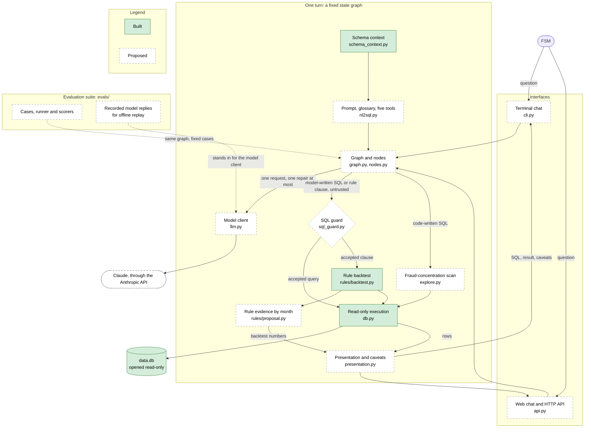
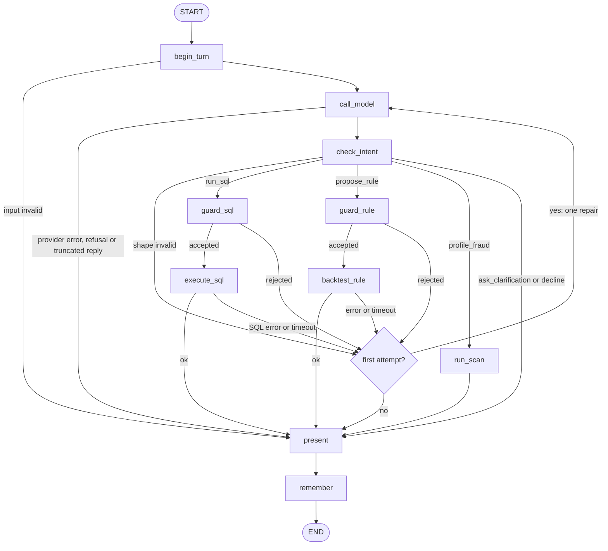

# Architecture

**Status: partly built.** Four modules are **Built** and tested: `config.py`, `db.py`, `schema_context.py` and `rules/backtest.py` ([details](#built-components)). Everything else on this page is **Proposed**: it is the target design, and those modules under `src/fsm_assistant/` are docstring-only placeholders. Nothing calls a model yet. Each section and table row says which is which. Decisions already made are in [`DECISIONS.md`](DECISIONS.md); what is still open is listed under [Open points](#open-points).

## Contents

- [Goal](#goal)
- [System overview](#system-overview)
- [How one turn works](#how-one-turn-works)
- [What is a tool and what is not](#what-is-a-tool-and-what-is-not)
- [Why this design works](#why-this-design-works)
- [Components](#components)
- [Built components](#built-components)
- [Backtest metrics](#backtest-metrics)
- [Outcomes](#outcomes)
- [Observability](#observability)
- [Where hallucination mitigations sit](#where-hallucination-mitigations-sit)
- [Evidence](#evidence)
- [Known weaknesses and planned fixes](#known-weaknesses-and-planned-fixes)
- [Evaluation](#evaluation)
- [Open points](#open-points)

## Goal

Support the workflow of a Fraud Success Manager (FSM), as the brief describes it ([`CHALLENGE.md`](CHALLENGE.md)):

1. **Explore**: ask a question in natural language, get the SQL and the result.
2. **Validate**: check a hypothesis against history.
3. **Propose a rule**: a SQL `WHERE` clause over `transactions`, shown with how it would have performed against `fraud_labels`.

The design principle: **the model only chooses and writes; code decides what runs, runs it and computes every number.** The model chooses one action and writes SQL or a short sentence. It never executes anything and never states a figure.

## System overview

The whole target system. Green boxes are built; dashed boxes are proposed.



Notes on the diagram:

- `config.py` (built) supplies settings to every box and is left out to keep the picture readable.
- The built boxes exist as tested functions, but nothing connects them yet: there is no graph, model client or interface.
- The web chat and its HTTP API are proposed and not in this repository yet. The terminal chat comes first.
- The only thing that will leave the machine by default is the request to Claude: the question, the schema context and the prompt. Result rows will never be sent to the model. Hosted tracing is a separate, opt-in switch (see [Observability](#observability)).

## How one turn works

**Proposed.** A turn is one FSM message and the reply to it. Each turn will run through a fixed state graph: a set of steps (nodes) connected by routes that code chooses. It will be built with LangGraph ([D-15](DECISIONS.md#d-15-langgraph-as-a-fixed-state-graph-not-an-agent-loop)).



`retry` is a routing function, not a node. One function, `graph.run_turn(question, conversation_id, settings, model)`, will be the single entry point for the terminal, the HTTP API and the evaluation suite, so all three exercise the same code.

### The nodes

All proposed. "Calls" names existing functions where they are built and planned ones otherwise.

| Node | Job | Calls | Writes to the turn's state |
|---|---|---|---|
| `begin_turn` | Empty and length check; reset every per-turn field | none | per-turn fields, `turn` |
| `call_model` | Build the messages; the only node that calls the model | `nl2sql.build_messages`, the model client in `llm.py` | `raw_reply`, `attempt`, `model_calls` |
| `check_intent` | Trim, drop one trailing `;`, check the reply is exactly one valid tool call, build a typed action | `nl2sql.check_shape` | `action` or `failure` |
| `guard_sql` | Compile-only policy check of a query | `sql_guard`, `db.inspect_query` | `approved_sql` or `failure` |
| `execute_sql` | Run the approved string, and only that | `db.run_query` (built) | `result` or `failure` |
| `guard_rule` | Containment and rule policy for a clause | `backtest.check_clause` (built), `sql_guard` | `approved_clause` or `failure` |
| `backtest_rule` | Backtest, then month-by-month evidence | `rules/backtest` (built), `rules/proposal` | `result` or `failure` |
| `run_scan` | Code-written fraud-concentration scan | `explore.scan` | `result`, `scan_seen` |
| `present` | Format hints, coded caveats, the outcome | `presentation` | `result`, `outcome` |
| `remember` | The only writer of conversation memory | none | `history` |

### The five tools

A tool, here, is a named action with typed arguments that the model can ask for. The model will be offered exactly five ([D-16](DECISIONS.md#d-16-the-model-chooses-one-of-five-tools-code-executes-it)):

| Tool | Arguments | What the graph will do with the call |
|---|---|---|
| `run_sql` | `sql`, `explanation`, `assumptions` | `guard_sql`, then `execute_sql` |
| `propose_rule` | `where_clause`, `explanation`, `assumptions` | `guard_rule`, then `backtest_rule` |
| `profile_fraud` | none | `run_scan` (code writes the SQL) |
| `ask_clarification` | `question`, `suggestions` (two or three) | Returned to the FSM; nothing runs |
| `decline` | `reason` | Returned to the FSM; nothing runs |

**The model never receives a tool result.** It picks one tool, a graph node validates and executes the call, and the turn ends. There is no agent loop: the model gets no chance to look at rows and decide on a further step.

### Walkthrough

Each step lists what will happen, why the step is there and what it protects against.

1. **`begin_turn`**
   - What: checks the message is not empty or over-long and resets the fields that belong to one turn.
   - Why: every turn must start from a clean state.
   - Protects against: paying for a model call on unusable input; an approved query from an earlier turn being run again.
2. **`call_model`**
   - What: builds one request from the prompt, the schema context (built), the glossary (fixed definitions such as "fraud rate"), a short "previous turn" block and the question, and sends it to Claude with the five tools.
   - Why: grounding the model in the real schema is what lets it write SQL that runs on this database.
   - Protects against: invented tables, columns and values. Being the only node that calls the model, it also keeps the number of requests countable.
3. **`check_intent`**
   - What: accepts a reply only if it is exactly one tool call with valid arguments, and turns it into a typed action. Plain text, two calls or an unknown tool is a shape failure.
   - Why: every later node needs to know which of five things was asked for.
   - Protects against: acting on free text; a reply that asks for two things at once.
4. **`guard_sql`** (for `run_sql`)
   - What: compiles the query without running it and reads what SQLite reports about it: it must be a single read-only `SELECT` over the seven known tables, with no denied function.
   - Why: a prompt instruction cannot be enforced; a check in code can.
   - Protects against: writes, reads of internal tables, extension loading, several statements in one string.
5. **`execute_sql`**
   - What: runs the string the guard approved, through `db.run_query` (built): read-only connection, timeout, row cap.
   - Why: the answer has to come from the data.
   - Protects against: running anything the guard did not see (the node reads `approved_sql`, which only `guard_sql` writes); runaway queries; oversized results.
6. **`guard_rule`** (for `propose_rule`)
   - What: applies the built containment check to the clause, then the rule policy: the clause must not read `fraud_labels` and must not use non-deterministic functions.
   - Why: a rule is text placed inside our backtest statement, so it must stay one expression and must not see the answers.
   - Protects against: a clause that changes what is measured; a clause that "predicts" fraud by reading the labels.
7. **`backtest_rule`**
   - What: runs the built backtest for the approved clause, then the month-by-month evidence.
   - Why: a rule without numbers is an opinion.
   - Protects against: a plausible rule that performs badly; a rule that only looks good in aggregate.
8. **`run_scan`** (for `profile_fraud`)
   - What: runs a fixed, code-written scan that ranks segments (for example city with state, hour, amount band) by their share of all labelled fraud.
   - Why: "where is the fraud?" is the question an FSM starts with, and it should not depend on the model writing eight correct queries.
   - Protects against: a model-written scan that misses a dimension or ranks by a misleading measure.
9. **`retry`** (a route, not a node)
   - What: after a shape failure, a guard rejection, a SQL error or a timeout on the first attempt, sends one fresh request: the original prompt plus a paragraph quoting the previous answer and the exact reason it failed. A second failure goes to `present` as a failure.
   - Why: many first failures are small (a wrong column name) and the error message is enough to fix them.
   - Protects against: unbounded cost. A turn makes at most two model requests, counted in state. A failure is shown as a failure, not papered over.
10. **`present`**
    - What: builds what the FSM sees: the SQL that ran, the result table, the rule with its backtest, caveats chosen by code from a fixed list, and one [outcome](#outcomes).
    - Why: the FSM must be able to check the answer, so the SQL is always next to the result.
    - Protects against: made-up numbers (every figure comes from executed SQL; the model's explanation is shown labelled as model text); a failure reaching the interface as a bare exception.
11. **`remember`**
    - What: stores a short record of the turn for the next one: the question, the kind of action, the accepted SQL or clause, any clarification asked. Result rows are not stored.
    - Why: a follow-up ("and for October?") needs the previous question and query.
    - Protects against: result rows flowing back to the model through a growing transcript.

### Invariants

Proposed. Each one will become a test.

1. No model-written SQL executes unless the guard accepted that exact string in the same turn.
2. Every execution goes through `db.run_query`.
3. At most two model requests per turn: one attempt, one repair.
4. Every figure in a result table or backtest comes from executed SQL.
5. A rule is never returned without its backtest.
6. Every failure maps to exactly one outcome.
7. Result rows are never saved in conversation memory and never placed in a model message.

## What is a tool and what is not

**Proposed.** Only choosing the action is a tool. Everything that touches safety or numbers is ordinary code that the model cannot call or skip.

| Capability | Form | Why |
|---|---|---|
| Choosing the action | Five tools the model can call: `run_sql`, `propose_rule`, `profile_fraud`, `ask_clarification`, `decline` | The model proposes an action by calling a tool; a node validates and executes it. The framework never runs a tool body on the model's behalf |
| SQL guard, rule policy, `check_clause` | Plain functions inside the guard nodes | Safety must not be skippable or callable by the model |
| `db.run_query` | Plain function called by `execute_sql` | Reachable only through `approved_sql` |
| Backtest and month-by-month evidence | Plain functions called by `backtest_rule` | Reachable only through `approved_clause` |
| Fraud scan | Plain function; a node and a terminal command | Code writes the SQL |
| Schema context, glossary | Prompt text | Static grounding, not a lookup |
| Routing, repair, outcomes | Routes in the graph | Code decides every route |

## Why this design works

The first four points describe the proposed design; the last two already hold in the built code.

**A fixed graph, not a free agent.** In an agent loop the model sees each tool result and chooses the next step. That is flexible, but it cannot promise that every query passes the guard, and a turn has no fixed cost. Here the routes are declared in code: a query can reach the database only through the guard, and a turn costs at most two model requests. The price is that the assistant cannot chain several steps in one turn; the FSM asks a follow-up instead.

**The model never states numbers.** Counts, rates, precision and recall come from executed SQL. The model is not shown result rows, so it has nothing to restate or round. Its explanation describes what the query returns and is shown labelled as model text.

**Four independent safety layers.** Each one holds if the others fail.

| Layer | What it does | Status |
|---|---|---|
| Prompt and the `decline` tool | Tells the model what is in scope and gives it a way to say no | Proposed |
| SQL guard | Compiles the SQL without running it and accepts a single read-only `SELECT` over known tables | Proposed |
| Read-only connection with its authorizer | SQLite itself refuses every action that is not a read | Built ([D-06](DECISIONS.md#d-06-read-only-is-enforced-in-three-engine-level-layers)) |
| Timeout and limits | A query is interrupted after a deadline; at most a fixed number of rows is fetched | Built ([D-07](DECISIONS.md#d-07-query-timeout-through-a-progress-handler), [D-08](DECISIONS.md#d-08-db-owns-the-row-cap)); a size limit on values is proposed |

**A rule is never shown without a backtest.** The only route from `propose_rule` to the FSM passes through `backtest_rule`.

**Clarifying beats guessing.** "Risky", "suspicious" and "high value" have no definition in the data. The prompt will tell the model to ask what is meant, with two or three suggestions, instead of picking a threshold silently.

**Precision and recall on labelled rows only (built).** About a third of transactions have no fraud label. They are unknown, not legitimate, so the backtest counts them separately and never as false positives ([D-11](DECISIONS.md#d-11-backtest-metrics-use-labelled-transactions-only-undefined-ratios-are-none)).

## Components

| Module | Responsibility | Status |
|---|---|---|
| `config.py` | Typed, validated settings from the environment and `.env` | Built |
| `db.py` | The only module that opens the database: read-only connection, timeout, row cap. Planned addition: `inspect_query` (compile only) | Built (addition Proposed) |
| `schema_context.py` | Describes the real schema to the model: tables, columns, allowed values, join keys, data notes | Built |
| `rules/backtest.py` | Measures a rule clause against the fraud labels. Planned addition: a by-month template | Built (addition Proposed) |
| `graph.py` | State, graph wiring, `run_turn`, export of the graph as a Mermaid diagram | Proposed |
| `nodes.py` | The node functions listed [above](#the-nodes) | Proposed |
| `llm.py` | The only module that talks to a model provider. One small interface with four implementations: live (Claude), recording, replay, scripted (for tests) | Proposed |
| `nl2sql.py` | Prompt assembly, glossary, the five tool schemas and typed actions, shape checks | Proposed |
| `sql_guard.py` | Query policy and rule policy, decided in code | Proposed |
| `explore.py` | Fraud-concentration scan | Proposed |
| `rules/proposal.py` | Rule policy, backtest, month-by-month evidence, lift (how many times the base fraud rate) | Proposed |
| `presentation.py` | Format hints (cents as dollars), coded caveats | Proposed |
| `cli.py` | Terminal interface: ask one question, chat, scan, print the graph, run the evaluation suite | Proposed (placeholder entry point today) |
| `api.py` | HTTP API for the web chat: one chat endpoint and one health endpoint | Proposed |
| Observability (no module assigned yet) | One local structured log line per graph node, always on; opt-in LangSmith tracing with result rows filtered out | Proposed |
| `evals/` | Cases, runner, scorers, recordings | Proposed |

## Built components

**`config.py`.** `load_settings()` returns an immutable `Settings` (database path, row cap, query timeout, and two model settings) from environment variables, with defaults. A `.env` file in the project root is read by a small built-in parser; real environment variables win ([D-09](DECISIONS.md#d-09-env-is-read-by-a-small-built-in-parser)). Invalid values raise `ConfigError` naming the variable. Loading does not touch the database or a model. The module still carries the earlier provider's settings (`OLLAMA_HOST`, `OLLAMA_MODEL` and `Settings.require_model()`), to be replaced by the Claude settings when the model layer is built ([D-14](DECISIONS.md#d-14-model-provider-anthropic-claude-through-its-api)); nothing uses them.

**`db.py`.** `run_query(sql, params, *, db_path, row_cap, timeout_seconds)` runs one statement on a fresh connection and returns a `QueryResult` (`columns`, `rows`, `row_count`, `truncated`, `elapsed_seconds`). It treats the SQL as untrusted and enforces everything in the engine, without parsing or rewriting the text:

- Read-only in three layers ([D-06](DECISIONS.md#d-06-read-only-is-enforced-in-three-engine-level-layers)): URI `mode=ro`, `PRAGMA query_only`, and an authorizer (a callback SQLite consults while it compiles a statement) that denies every action except reads (`SELECT`, column reads, functions, recursive CTEs, and the two schema pragmas `table_info` and `foreign_key_list`). The authorizer is the layer that stops `ATTACH`, `VACUUM INTO` and temp tables.
- Timeout ([D-07](DECISIONS.md#d-07-query-timeout-through-a-progress-handler)): a progress handler interrupts the statement after the deadline.
- Row cap ([D-08](DECISIONS.md#d-08-db-owns-the-row-cap)): at most `row_cap` rows are fetched, plus one to set `truncated`.
- One statement per call (`execute`, never `executescript`).
- Typed errors, all subclasses of `DbError`: `ReadOnlyViolation`, `QueryTimeout`, `QueryError` (keeps SQLite's message in `sqlite_message` for the repair attempt), `DatabaseNotFoundError`.

**`schema_context.py`.** `build_schema_context(db_path)` returns the text that will be given to the model, about 3,300 characters for the real database. Tables, columns, types, primary and foreign keys, row counts, NULL counts, the distinct values of low-cardinality `TEXT`/`BOOLEAN` columns (listed when there are at most 12) and the figures in the notes are read from the database through `db`. The notes cover cents, negative amounts, date format and range, case-sensitive values, the label join ([D-10](DECISIONS.md#d-10-the-schema-context-prescribes-one-form-of-the-label-join)), partial label coverage, the path to MCC, and how locations are encoded. Output is sorted and has nothing time-dependent, so two builds are byte-identical; it is cached per path for the life of the process.

**`rules/backtest.py`.** `backtest(clause, *, db_path, timeout_seconds)` measures a rule, given as a `WHERE` clause over `transactions`, and returns an immutable `BacktestResult`. The caller supplies only the clause; the numbers come from one fixed statement run through `db.run_query`:

```sql
WITH flagged AS (
  SELECT id, amount_usd_cents FROM transactions WHERE (
<clause>
  )
)
SELECT count(flagged.id), count(f.is_fraud), sum(f.is_fraud = 1), sum(f.is_fraud = 0),
       <three amount sums>,
       (SELECT count(*) FROM transactions),
       (SELECT count(is_fraud) FROM fraud_labels),
       (SELECT sum(is_fraud = 1) FROM fraud_labels)
FROM flagged
LEFT JOIN fraud_labels f ON f.transaction_id = CAST(flagged.id AS TEXT)
```

- Scope ([D-12](DECISIONS.md#d-12-one-backtest-template-the-clause-sees-only-transactions)): inside the CTE the only table is `transactions`, unaliased, so a clause uses bare column names or `transactions.<column>`, and subqueries on other tables work as in the brief's example. The labels are joined afterwards, so `id` in a clause can only be `transactions.id`, and `is_fraud` is not a column a clause can use directly.
- Metrics ([D-11](DECISIONS.md#d-11-backtest-metrics-use-labelled-transactions-only-undefined-ratios-are-none)): defined [below](#backtest-metrics).
- Containment ([D-13](DECISIONS.md#d-13-a-rule-clause-is-contained-by-parentheses-and-a-lexical-scan)): `check_clause` scans the clause, following SQLite's quoting rules, and rejects `;`, comments, bind parameters, NUL and any parenthesis that is unbalanced or would close the template's own. The clause is then compiled once as it would be written after a bare `WHERE` (`EXPLAIN`, not executed) and run inside the template's parentheses, so it has to be a single expression in both positions.
- Errors: `RuleClauseError` with a `reason`, and SQLite's message verbatim in `sqlite_message` when SQLite rejected the clause (for the repair attempt). `db.QueryTimeout` and the other `db` errors propagate unchanged.
- Cost on the real database: one scan of `transactions` for the clause, an index lookup per flagged row, and the three totals; 0.04 to 0.2 s for selective rules and about 0.9 s for a rule that flags every transaction.
- Not checked here: which tables and columns a clause reads. That is `sql_guard`'s job (proposed). Until it exists, a clause can read `fraud_labels` in a subquery and so "predict" from the labels themselves, and a non-deterministic clause (`random()`) is measured as if it were a rule. See [Known weaknesses](#known-weaknesses-and-planned-fixes).

## Backtest metrics

Built, as implemented in `BacktestResult`. "Labelled" means the transaction has a row in `fraud_labels`.

| Field | Definition |
|---|---|
| `flagged` | Transactions matching the rule, labelled or not |
| `flagged_labelled`, `flagged_unlabelled` | The flagged transactions with and without a label |
| `true_positives` | Flagged and labelled fraud (fraud caught) |
| `false_positives` | Flagged and labelled not fraud (legitimate payments the rule would have blocked) |
| `false_negatives` | Labelled fraud not flagged: `total_fraud − true_positives` |
| `total_transactions`, `total_labelled`, `total_fraud` | Dataset totals: 1,159,966, 777,339 and 1,360 on the shipped data |
| `precision` | `true_positives / flagged_labelled`; `None` when nothing flagged is labelled |
| `recall` | `true_positives / total_fraud`; `None` when there is no labelled fraud |
| `flag_rate` | `flagged / total_transactions`, over all transactions, labelled or not |
| `flagged_label_coverage` | `flagged_labelled / flagged`: the share of the flagged set that precision is based on |
| `flagged_amount_cents`, `fraud_amount_caught_cents`, `false_positive_amount_cents` | Sum of `amount_usd_cents` over all flagged, the true positives and the false positives. Net sums: negative amounts are not treated specially |

Unlabelled flagged transactions count in `flagged`, `flag_rate` and `flagged_amount_cents` only; they are never counted as legitimate. The total amount of labelled fraud in the dataset (an amount-based recall) is not computed: it needs a second pass over the label join.

Proposed addition: the same counts per calendar month, so a rule's weakest month is visible (see the overfitting row under [Known weaknesses](#known-weaknesses-and-planned-fixes)).

## Outcomes

**Proposed.** Every turn will end in exactly one outcome. `status` and `error.kind` are the fields an interface will read.

| Outcome | When | `status` | `error.kind` |
|---|---|---|---|
| answered | SQL or the scan ran (zero rows still counts) | `ok` | none |
| rule_proposed | Clause accepted and backtested | `ok` | none |
| clarification | The model called `ask_clarification` | `needs_clarification` | none |
| cannot_answer | The model called `decline` | `cannot_answer` | none |
| rejected | The guard refused twice | `rejected` | `sql_rejected` |
| failed | SQL error or timeout twice | `error` | `sql_execution` or `timeout` |
| failed | Empty or over-long message (no model call) | `error` | `invalid_input` |
| failed | Provider unreachable, key missing or overloaded | `error` | `model_unavailable` |
| failed | Invalid model output twice, a refusal or a truncated reply | `error` | `model_output` |
| failed | Anything else | `error` | `internal` |

Caveats will be chosen by code from a fixed list, in a fixed order: result cut at the row cap; label coverage, when `fraud_labels` is read; zero rows (with a hint to check the spelling and case of values); small sample (fewer than 30 labelled rows flagged); high flag rate (over 5% of transactions); a month with precision below half the rule's overall precision.

## Observability

**Proposed.** Observability means being able to see, after the fact, what the assistant did in a turn, step by step. Two parts are planned.

**Local structured logs, always on.** Each graph node will write one line with named fields: conversation id, turn, node, duration, attempt number, tool chosen, guard decision and reason, outcome, error kind, row count, model id, token usage and request id. The lines will go to a git-ignored file on the machine, with a readable form in the terminal on request. No external service is involved. The question and the SQL will be logged, because they are what a reviewer needs to see. The API key and result rows will never be logged: rows appear as a count only.

**LangSmith tracing, opt-in.** LangSmith is a hosted service that records each step of a LangGraph run as a trace. It will be off unless the owner switches it on with a setting and supplies a LangSmith key. When it is on, the question, the schema context, the tool call and the SQL will be sent to it. Result rows will not: the inputs and outputs of each node will be filtered so that a trace carries row counts and column names, never rows.

With tracing off, nothing leaves the machine except the model call.

These log fields are also what the online metrics in the [README](../README.md#evaluation) would be computed from.

## Where hallucination mitigations sit

Hallucination means the model producing something that looks right and is not: a column that does not exist, a number it did not compute.

| Risk | Mitigation | Where | Status |
|---|---|---|---|
| Invented tables, columns or values (`amount`, `'debit'`) | Schema context built from the real database, including allowed values | `schema_context` | Built |
| | Tables checked against the seven real ones before execution; SQLite rejects unknown columns at compile time, and the message feeds the single repair | `sql_guard` | Proposed |
| Destructive or runaway SQL | Read-only connection, timeout and row cap | `db` | Built |
| | Single read-only `SELECT` accepted by a compile-only check | `sql_guard` | Proposed |
| SQL that runs but answers a different question | SQL always shown with the result; the model's assumptions (for example the date range it resolved) listed | `presentation` | Proposed |
| | Execution accuracy measured on reference cases | `evals/` | Proposed |
| Made-up numbers in prose | Backtest figures come from one fixed statement | `rules/backtest` | Built |
| | The model is never shown result rows and its text is labelled as model text | `graph`, `presentation` | Proposed |
| A plausible rule that performs badly | The backtest that measures a clause against the labels | `rules/backtest` | Built |
| | No route shows a rule without its backtest | `graph` | Proposed |
| Misleading fraud rates from partial labels | Metrics on labelled rows only, coverage reported; the join pattern fixed in code; the schema context states the coverage and the join to use | `rules/backtest`, `schema_context` | Built |
| A rule that reads the labels it is scored against | Rule policy rejects any read of `fraud_labels` in a clause | `sql_guard` | Proposed |
| Questions the data cannot answer, or vague wording | `decline` and `ask_clarification` tools; such cases in the evaluation set | `nl2sql`, `evals/` | Proposed |
| Overfitting a rule to history | Month-by-month evidence; scoring on months the rule was not derived from | `rules/proposal` | Proposed |

The FSM stays in the loop throughout: the tool proposes rules, it does not deploy them.

## Evidence

Exploratory checks were run before this design was chosen. **They are not the evaluation suite**, which does not exist yet, and the samples are small. They show that the approach is workable and where it breaks; they do not measure how well the finished system performs. Claude has not been run yet.

**Compile-only inspection.** Compiling a statement with `EXPLAIN` under SQLite's authorizer, without running it, took under 1 ms per statement. It reported the real tables and the functions used, through joins, CTEs, subqueries, aliases, views and `SELECT *`. Multi-statement input, statements that change data or structure, `ATTACH`, `PRAGMA`, reads of `sqlite_master` and `load_extension` were all rejected or made visible by it. Its blind spots are in the [next section](#known-weaknesses-and-planned-fixes).

**Speed on the real database.** Typical analyst queries ran in 0.5 to 1.5 s and backtests in 0.07 to 1 s. The brief's example rule, written with the real column and value names, flags 350 transactions: 238 labelled, 2 fraud caught, 236 false positives.

**Two local open models, 15 questions, the real schema context.**

- Every reply matched the requested JSON shape.
- 10 and 12 of the 15 were correct on the first attempt.
- Both models refused a delete request, a prompt injection (text in the question that tries to override the instructions) and a question about a column that does not exist. Both asked for clarification on "risky transactions".
- Failures: rule clauses that used a column from another table as if it were on `transactions` (3 of 3, fixed by one sentence about scope and one example); a wrong fraud-rate formula on the smaller model; "last month" read two different ways.

These failures shaped the planned prompt and glossary: a fixed fraud-rate formula, relative dates resolved against the last date in the data (2019-10-31), and the rule scope sentence.

## Known weaknesses and planned fixes

Found in the same checks. Every fix in this table is **Proposed**; the weaknesses are real today in the built code or would be real in a guard built naively.

| Problem | Why it matters | Planned fix |
|---|---|---|
| The authorizer does not see function arguments, so `date('now')` passes. On data that ends in 2019, a filter relative to today silently returns nothing | The FSM would read "no rows" as an answer | A text check that rejects a `'now'` literal and date functions called without arguments; the glossary resolves relative dates against 2019-10-31 and the range is listed as an assumption |
| A clause can read `fraud_labels` in a subquery. Checked: a clause that selects the labelled-fraud ids scores precision 1.0 and recall 1.0. The backtest template itself joins `fraud_labels`, so inspecting the whole statement cannot tell a leaking clause from a clean one | A rule that reads the answers looks perfect and is useless | Inspect the clause alone, in the bare form the backtest already compiles, and reject any read of `fraud_labels` |
| SQLite turns a double-quoted name it does not recognise into a string literal: `"amount" > 1000` compares text with a number and matches every row (1,159,966) | A wrong column name gives a confident wrong answer instead of an error | Switch that fallback off on the connection, so an unknown name is an error the repair can use |
| The timeout is checked between SQLite's internal steps, so one very heavy single operation can outrun it | The deadline is not a hard bound | Cap the size of any one value on the connection (1,000,000 bytes) |
| `VACUUM` leaves an empty authorizer record, and a model-written `EXPLAIN` returns a query plan instead of an answer | An empty record could be mistaken for "nothing dangerous"; a plan is not what was asked | The guard requires the first recorded action to be `SELECT`, and rejects an empty record and a model-written `EXPLAIN` |
| Date-range trap: `date` holds timestamps, so `BETWEEN '2019-01-01' AND '2019-01-31'` drops the whole of the 31st: 114,138 rows instead of 118,116 | A monthly figure that is about 3% low with no sign of error | Glossary rule: ranges end with `<` the next day, never `BETWEEN` on a day; a trap case in the evaluation set |
| Join fan-out: joining `merchant_locations` on `merchant_id` instead of the location key pairs each transaction with every location of its merchant, about 440 million rows | Inflated counts, or a timeout | The glossary gives the join key (`transactions.merchant_location_id = merchant_locations.id`); a trap case in the evaluation set; the timeout bounds the damage |
| Velocity questions (how many transactions a card makes in a short time) time out when written as a self-join, and take about 1 s with a window function | A common fraud question would fail | The glossary prescribes a window function (`lag() OVER`), with one example; a trap case in the evaluation set |
| Rule overfitting. A data fact: all 1,360 fraud labels sit at merchant locations in Rome, Italy. The rule "location is in Rome, Italy" flags 2,431 transactions: 1,598 labelled, 1,360 caught, 238 false positives (precision 0.851, recall 1.0). March is its weakest month, at 50% precision | With all fraud in one segment, strong backtest numbers here do not prove that a rule generalises to other data or other periods | Show the evidence month by month and name the worst month; score a rule on months it was not derived from |

## Evaluation

**Proposed; nothing is built.** The suite will run fixed cases through `graph.run_turn`, the same entry point the interfaces use, so results describe the real system.

**Cases.** About 25, in one file. A starter tier of ten: five answerable questions with known results (1,159,966 transactions; 777,339 labelled; 1,360 fraud; a fraud rate of 0.175% of labelled transactions; 56,900 negative amounts) and five that must not be answered (a delete request, vague "risky", a missing column, a prompt injection, a rule that reads the labels). Then joins, aggregates over labels, follow-up questions, the three traps from the table above (date range, fan-out, velocity), the scan and rules. Cases the prompt was tuned on will be marked, and a few paraphrases will be written after the prompt is frozen.

**Scorers.**

| Scorer | Passes when |
|---|---|
| Execution accuracy | The generated query's result equals the reference result |
| Guardrail | Nothing unsafe was executed |
| Clarification and refusal | Vague or unanswerable questions end in `clarification`, `cannot_answer` or `rejected`, not in an answer |
| Rule arithmetic | The reported backtest equals an independent recomputation |
| Rule match | The rows the proposed clause flags are compared with a reference clause for that case, reported as overlap |
| Scan | The top segment is Rome, Italy |

Two reference rules anchor the rule cases: a known-bad one (the brief's example: 350 flagged, 238 labelled, 2 caught, 236 false positives) and a known-good one (the Rome, Italy location rule: 2,431, 1,598, 1,360, 238).

**Result comparison rules.** By column position, ignoring column names. Rows as a multiset (order ignored) unless the case says the order matters. Numbers equal within a relative difference of 1e-6. Rates as fractions. Extra columns fail. A truncated result fails.

**Reporting.** Counts per tier, never a single accuracy percentage: the sample is small. Each run will record the model, its settings, the prompt version and hashes of the schema context and the case file.

**Offline replay.** A live run will record each model reply. A replay run feeds the recordings through the real guard, database and scorers, with no model, no key and no network, so a reviewer can run the suite with one command in seconds. Each recording will be stored with a hash of the request that produced it; if the prompt, the tools or the model settings change, replay stops with "stale recording" instead of passing silently.

- What replay proves: that the recorded model output, scored by the real code, gives the reported results, and that the guard, execution, backtest and scorers behave as described.
- What replay does not prove: how the live model behaves today. Claude's output is not reproducible from a seed, so a new live run can differ from the recording.

Offline and online metrics for stakeholders are discussed in the [README](../README.md#evaluation).

## Open points

Only what is still undecided. Everything else on this page is either built or a settled design waiting to be built.

| # | Point | How it will be settled |
|---|---|---|
| 1 | Which model-output mode is the default: the five tools, or the single schema-constrained object ([D-16](DECISIONS.md#d-16-the-model-chooses-one-of-five-tools-code-executes-it)) | A measurement when the model layer is built: how often the default model replies with exactly one valid tool call |
| 2 | The model's effort level (how much reasoning it is asked to spend) | Chosen with the model layer; a setting either way |
| 3 | Whether the smaller model (`claude-haiku-5-5`) becomes the default | The evaluation suite run on both models; it becomes the default if it scores the same |
| 4 | Whether the web chat is built, and whether a rule card gets accept and reject buttons | Time. Both come after the terminal chat and the evaluation suite |
