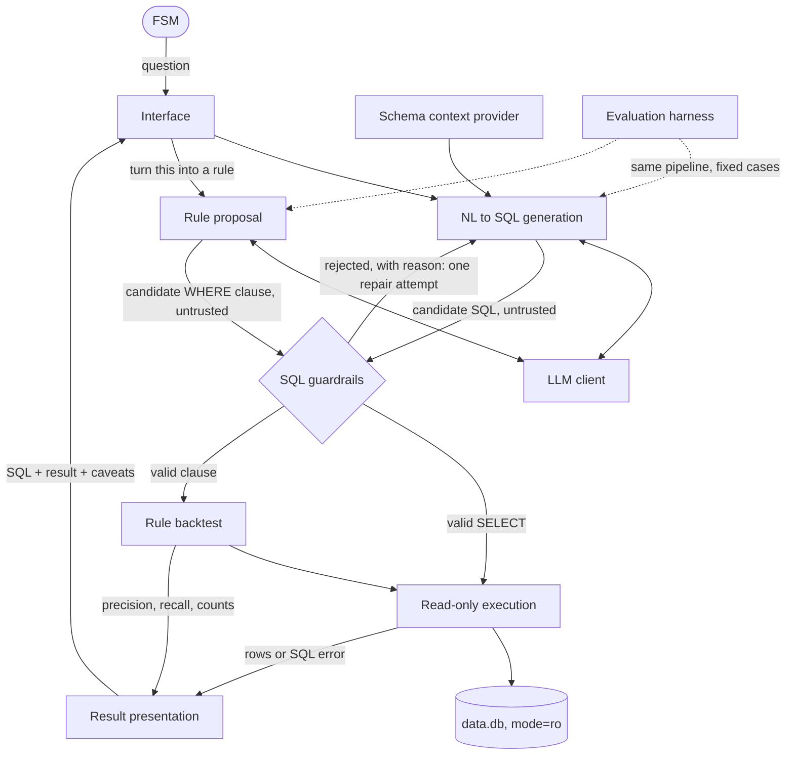

# Architecture

**Status: partly implemented.** Configuration, read-only execution, the schema context provider and the rule backtest are built and tested ([details](#implemented-components)). Everything else is proposed: those modules under `src/fsm_assistant/` are docstring-only placeholders. The Status column below says which is which. Decisions already made are in [`DECISIONS.md`](DECISIONS.md); those still open are listed [below](#open-decisions).

## Goal

Support the FSM workflow from the brief ([`CHALLENGE.md`](CHALLENGE.md)):

1. **Explore**: ask a question in natural language, get the SQL and the result.
2. **Validate**: check a hypothesis against history.
3. **Propose a rule**: a SQL `WHERE` clause over `transactions`, shown with how it would have performed against `fraud_labels`.

The design principle: **the model writes SQL and prose; code decides what runs and computes every number.**

## Components

| Component | Module | Responsibility | Status |
|---|---|---|---|
| Interface (thin) | `cli.py` | Take the question, show SQL, result, rule and backtest. No business logic | Proposed (placeholder entry point) |
| Schema context provider | `schema_context.py` | Describe the real schema to the model: tables, columns, allowed values, join keys, data notes from [`DATA.md`](DATA.md) | Implemented |
| NL → SQL generation | `nl2sql.py` | Question + schema context → one candidate `SELECT`, or a clarifying question / refusal | Proposed |
| LLM client | `llm.py` | The only module that calls a model provider (a local Ollama server running a Qwen model, [D-05](DECISIONS.md#d-05-llm-provider-local-ollama-with-qwen)); replaceable by a scripted fake in tests | Proposed |
| SQL validation / guardrails | `sql_guard.py` | Single statement, `SELECT` only, known tables and columns. Also validates rule `WHERE` clauses. Does not own the row limit ([D-08](DECISIONS.md#d-08-db-owns-the-row-cap)) | Proposed |
| Read-only execution | `db.py` | The only module that opens the database and the single place a query runs: read-only connection, query timeout, row cap with a truncation flag | Implemented |
| Result presentation | `presentation.py` | SQL shown next to the result, cents as dollars, caveats (for example label coverage) | Proposed |
| Rule proposal | `rules/proposal.py` | Insight → candidate `WHERE` clause over `transactions` + plain-language description | Proposed |
| Rule backtesting | `rules/backtest.py` | Run the rule over history; compute flagged count, fraud caught, precision, recall, false positives, on labelled transactions only | Implemented (not yet called by a pipeline or interface) |
| Configuration | `config.py` | Typed, validated settings from the environment and `.env` | Implemented |
| Evaluation harness | `evals/` | Run a fixed set of cases through the same pipeline and score them | Proposed |

## Implemented components

**`config.py`.** `load_settings()` returns an immutable `Settings` (database path, `OLLAMA_HOST`, `OLLAMA_MODEL`, row cap, query timeout) from environment variables, with defaults. A `.env` file in the project root is read by a small built-in parser; real environment variables win ([D-09](DECISIONS.md#d-09-env-is-read-by-a-small-built-in-parser)). Invalid values raise `ConfigError` naming the variable. Loading does not touch the database or Ollama: a missing database file is reported by `db` when a query runs, and a missing model name by `Settings.require_model()` when a model is requested.

**`db.py`.** `run_query(sql, params, *, db_path, row_cap, timeout_seconds)` runs one statement on a fresh connection and returns a `QueryResult` (`columns`, `rows`, `row_count`, `truncated`, `elapsed_seconds`). It treats the SQL as untrusted and enforces everything in the engine, without parsing or rewriting the text:

- Read-only in three layers ([D-06](DECISIONS.md#d-06-read-only-is-enforced-in-three-engine-level-layers)): URI `mode=ro`, `PRAGMA query_only`, and an authorizer callback that denies every action except reads (`SELECT`, column reads, functions, recursive CTEs, and the two schema pragmas `table_info` and `foreign_key_list`). The authorizer is the layer that stops `ATTACH`, `VACUUM INTO` and temp tables.
- Timeout ([D-07](DECISIONS.md#d-07-query-timeout-through-a-progress-handler)): a progress handler interrupts the statement after the deadline.
- Row cap ([D-08](DECISIONS.md#d-08-db-owns-the-row-cap)): at most `row_cap` rows are fetched, plus one to set `truncated`.
- One statement per call (`execute`, never `executescript`).
- Typed errors, all subclasses of `DbError`: `ReadOnlyViolation`, `QueryTimeout`, `QueryError` (keeps SQLite's message in `sqlite_message` for the repair attempt), `DatabaseNotFoundError`.

**`schema_context.py`.** `build_schema_context(db_path)` returns the text given to the model, about 3,300 characters for the real database. Tables, columns, types, primary and foreign keys, row counts, NULL counts, the distinct values of low-cardinality `TEXT`/`BOOLEAN` columns (listed when there are at most 12) and the figures in the notes are read from the database through `db`. The notes cover cents, negative amounts, date format and range, case-sensitive values, the label join ([D-10](DECISIONS.md#d-10-the-schema-context-prescribes-one-form-of-the-label-join)), partial label coverage, the path to MCC, and how locations are encoded. Output is sorted and has nothing time-dependent, so two builds are byte-identical; it is cached per path for the life of the process.

**`rules/backtest.py`.** `backtest(clause, *, db_path, timeout_seconds)` measures a rule, given as a `WHERE` clause over `transactions`, and returns an immutable `BacktestResult`. The caller supplies only the clause; the numbers come from one fixed statement run through `db.run_query`:

```sql
WITH flagged AS (
  SELECT id, amount_usd_cents FROM transactions WHERE (
<clause>
  )
)
SELECT count(flagged.id), count(f.is_fraud), sum(f.is_fraud = 1), sum(f.is_fraud = 0),
       <three amount sums>,
       (SELECT count(*) FROM transactions),
       (SELECT count(is_fraud) FROM fraud_labels),
       (SELECT sum(is_fraud = 1) FROM fraud_labels)
FROM flagged
LEFT JOIN fraud_labels f ON f.transaction_id = CAST(flagged.id AS TEXT)
```

- Scope ([D-12](DECISIONS.md#d-12-one-backtest-template-the-clause-sees-only-transactions)): inside the CTE the only table is `transactions`, unaliased, so a clause uses bare column names or `transactions.<column>`, and subqueries on other tables work as in the brief's example. The labels are joined afterwards, so `id` in a clause can only be `transactions.id`, and `is_fraud` is not a column a clause can use directly.
- Metrics ([D-11](DECISIONS.md#d-11-backtest-metrics-use-labelled-transactions-only-undefined-ratios-are-none)): defined [below](#backtest-metrics).
- Containment ([D-13](DECISIONS.md#d-13-a-rule-clause-is-contained-by-parentheses-and-a-lexical-scan)): `check_clause` scans the clause, following SQLite's quoting rules, and rejects `;`, comments, bind parameters, NUL and any parenthesis that is unbalanced or would close the template's own. The clause is then compiled once as it would be written after a bare `WHERE` (`EXPLAIN`, not executed) and run inside the template's parentheses, so it has to be a single expression in both positions.
- Errors: `RuleClauseError` with a `reason`, and SQLite's message verbatim in `sqlite_message` when SQLite rejected the clause (for the repair attempt). `db.QueryTimeout` and the other `db` errors propagate unchanged.
- Cost on the real database: one scan of `transactions` for the clause, an index lookup per flagged row, and the three totals; 0.04 to 0.2 s for selective rules and about 0.9 s for a rule that flags every transaction.
- Not checked here: which tables and columns a clause reads. That is `sql_guard`'s job (proposed). Until it exists, a clause can read `fraud_labels` in a subquery and so "predict" from the labels themselves, and a non-deterministic clause (`random()`) is measured as if it were a rule.

## Data flow

The target flow. Only the boxes whose component is marked Implemented in the [table above](#components) exist; nothing connects them yet.



Exploration path: question → generate → validate → execute read-only → present. A validation failure or SQL error is returned to the model once with the reason; a second failure is shown to the FSM as a failure, not papered over.

Rule path: the candidate clause is validated, then backtested with fixed SQL templates written by us (the model supplies only the `WHERE` clause). A rule filters `transactions`, and the clause may contain read-only subqueries against other known tables, as in the brief's example (`card_id IN (SELECT id FROM cards WHERE …)`); the same validation applies inside them. The FSM always sees the rule next to its measured performance.

### Backtest metrics

As implemented in `BacktestResult`. "Labelled" means the transaction has a row in `fraud_labels`.

| Field | Definition |
|---|---|
| `flagged` | Transactions matching the rule, labelled or not |
| `flagged_labelled`, `flagged_unlabelled` | The flagged transactions with and without a label |
| `true_positives` | Flagged and labelled fraud (fraud caught) |
| `false_positives` | Flagged and labelled not fraud (legitimate payments the rule would have blocked) |
| `false_negatives` | Labelled fraud not flagged: `total_fraud − true_positives` |
| `total_transactions`, `total_labelled`, `total_fraud` | Dataset totals: 1,159,966, 777,339 and 1,360 on the shipped data |
| `precision` | `true_positives / flagged_labelled`; `None` when nothing flagged is labelled |
| `recall` | `true_positives / total_fraud`; `None` when there is no labelled fraud |
| `flag_rate` | `flagged / total_transactions`, over all transactions, labelled or not |
| `flagged_label_coverage` | `flagged_labelled / flagged`: the share of the flagged set that precision is based on |
| `flagged_amount_cents`, `fraud_amount_caught_cents`, `false_positive_amount_cents` | Sum of `amount_usd_cents` over all flagged, the true positives and the false positives. Net sums: negative amounts are not treated specially |

Unlabelled flagged transactions count in `flagged`, `flag_rate` and `flagged_amount_cents` only; they are never counted as legitimate. The total amount of labelled fraud in the dataset (an amount-based recall) is not computed: it needs a second pass over the label join.

## Where hallucination mitigations sit

Mitigations in `schema_context`, `db` and `rules/backtest` are implemented. Those in `sql_guard`, `nl2sql`, `presentation` and `evals/` are proposed.

| Risk | Mitigation | Where |
|---|---|---|
| Invented tables, columns or values (`amount`, `'debit'`) | Schema context built from the real database, including allowed values; identifiers checked against the schema before execution | `schema_context`, `sql_guard` |
| Destructive or runaway SQL | `SELECT`-only validation (proposed), plus a read-only connection, timeout and row cap as an independent second layer (implemented) | `sql_guard`, `db` |
| SQL that runs but answers a different question | SQL always shown with the result; execution accuracy measured on reference cases | `presentation`, `evals/` |
| Made-up numbers in prose | Every figure comes from an executed query; the model does not state metrics (the backtest side is implemented) | `presentation`, `rules/backtest` |
| A plausible rule that performs badly | No rule shown without a backtest | `rules/backtest` |
| Misleading fraud rates from partial labels | Metrics on labelled rows only, coverage reported; the join pattern is fixed in code; the schema context states the coverage and the join to use (all implemented) | `rules/backtest`, `schema_context` |
| Questions the data cannot answer | The model may refuse or ask for clarification; such cases are in the eval set | `nl2sql`, `evals/` |
| Overfitting a rule to history | Out of MVP scope; candidate mitigation is a time-based split (propose on earlier months, test on later) | Next steps |

The FSM stays in the loop throughout: the tool proposes rules, it does not deploy them.

## Evaluation harness

Proposed; nothing is built. It will run fixed cases through the same code path the interface uses, so results describe the real system. Intended scorers:

- **Execution accuracy**: the generated query's result equals the reference query's result (compared as result sets, not SQL text).
- **Guardrail cases**: write attempts, multi-statement input and prompt injection never execute.
- **Refusal / clarification cases**: unanswerable or ambiguous questions are not answered with invented SQL.
- **Rule cases**: a proposed rule is a valid `WHERE` clause over `transactions`, and its reported metrics equal an independent recomputation.

Offline and online metrics for stakeholders are discussed in the [README](../README.md#evaluation).

## Open decisions

Settled since this list was written: the LLM provider is local Ollama with a Qwen model ([D-05](DECISIONS.md#d-05-llm-provider-local-ollama-with-qwen)). What remains of that item is row 1.

Not decided. Each has a suggested default, which is a suggestion only.

| # | Decision | Options | Suggested default (not decided) |
|---|---|---|---|
| 1 | Default Qwen model | `qwen3:14b` or `qwen3:30b-a3b` (the two installed models, details in D-05) | None. Run the evaluation suite against both and pick from the results; the model name is configuration (`OLLAMA_MODEL`) either way |
| 2 | Interface | CLI, or a minimal web UI such as Streamlit | CLI first (fastest path to working core, easy to script and test); add a minimal Streamlit page only if time remains, since result tables read better there |
| 3 | Eval dataset design | Hand-written question/reference-SQL pairs; size; difficulty tiers; how refusal and rule cases are represented; file format | A small hand-written set (roughly 20-30 cases) in one YAML file, tiered single-table / joins / aggregates over labels / unanswerable / adversarial, scored by result-set comparison |

Smaller points to settle during implementation: SQL validation method (parser library vs strict allow-list), single-shot vs multi-turn conversation, whether to run eval cases more than once to measure variance, and how `llm.py` talks to Ollama (the official `ollama` Python package, plain HTTP, or its OpenAI-compatible endpoint; a new dependency needs approval), including whether Qwen's thinking mode stays on and which context window size to run with.
